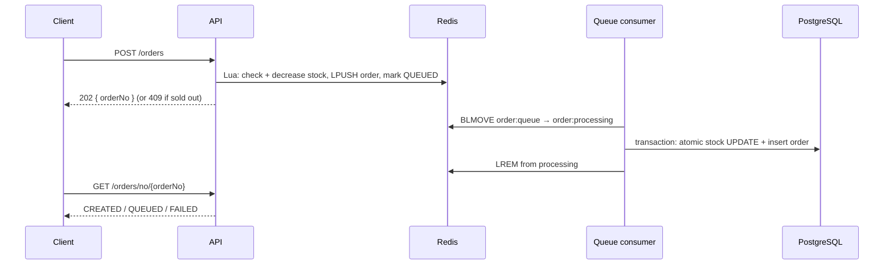

# Flash Sale Inventory

A flash-sale backend built with Spring Boot, PostgreSQL and Redis. I first reproduced overselling under load, then
fixed it step by step and measured each step with load tests.

- **No oversell**: Redis Lua scripts decide who gets stock, and an atomic SQL `UPDATE` guards the database.
- **Requests don't wait for the database**: winning orders go onto a Redis queue and get `202` right away. A
  background consumer writes them to PostgreSQL.
- **Every step has evidence**: a Testcontainers concurrency test, plus load-test numbers (below) for each stage.


## Tech stack

Java 17 · Spring Boot 4 (Web MVC, Data JPA, Security + JWT, Validation) · PostgreSQL 16 + Flyway · Redis 7 (Lua
scripts, cache-aside, List as a queue) · Testcontainers, Awaitility · GitHub Actions · [oha](https://github.com/hatoo/oha) for load tests

## How an order works



- **One Lua script per Redis step**, so a crash can't leave stock taken without an order queued, or stock given back twice.
- **Reliable queue**: `BLMOVE` keeps each message in a processing list until it is written; leftovers are requeued on startup.
- **Idempotent consumer**: each order carries a UUID `order_no` (unique in the database), so a message handled twice
  never creates two orders or takes stock twice.
- **Failure handling**: unreadable messages go to a dead-letter list; orders the database rejects give their Redis
  stock back and are marked `FAILED`; temporary errors are retried.
- **Product reads** use cache-aside with TTL jitter, null caching, delayed double delete after commit, and fall back
  to the database when Redis is down.

## How it got here

| Stage | Change | Result |
|---|---|---|
| Naive | read stock → subtract in Java → write back | Oversold: 500 orders for 100 items at 10+ concurrent requests |
| Atomic SQL | `UPDATE ... SET stock = stock - ? WHERE stock >= ?` | 0 oversell at every concurrency level |
| Redis gate | Lua script decreases stock in Redis first; only winners reach the database | 831 vs 542 RPS at 200 concurrent, half the latency |
| Product cache | cache-aside for product reads | 4,887 → 17,726 RPS; database transactions ~5,000 → 0 |
| Order queue | winners are queued; a consumer writes them | see below |

**Queue vs. synchronous Redis gate** (stock 5,000, 10,000 requests, same machine, same script):

| Concurrency | Version | RPS | p99 latency | All orders in DB after |
|---|---|---|---|---|
| 50 | synchronous | 305 | 497 ms | 33 s |
| 50 | queue | **2,595** | **30 ms** | 80 s |
| 200 | synchronous | 320 | 1,452 ms | 31 s |
| 200 | queue | **2,491** | **173 ms** | 81 s |

Requests got about 8× faster. The database itself did not: one consumer writes about 63 orders/s, while the
synchronous version wrote through 10 pooled connections in parallel. The queue moves the wait off the request path;
running several consumers is the next step.

All runs are on one laptop with the load generator on the same machine, so the numbers are for comparison, not absolute capacity.

## API

| Method | Path | |
|---|---|---|
| POST | `/auth/register`, `/auth/login` | returns a JWT |
| GET / POST / PUT / DELETE | `/products`, `/products/{id}` | product reads are cached |
| GET / POST / DELETE | `/inventory`, `/inventory/{id}` | |
| POST | `/orders` | `202 { orderNo, status: "QUEUED" }`, `409` if sold out |
| GET | `/orders/no/{orderNo}` | `CREATED` (with the order), `QUEUED` or `FAILED`; other users' orders → `404` |
| GET | `/orders`, `/orders/{id}` | the current user's orders only |

Everything except `/auth/**` and Swagger needs `Authorization: Bearer <token>`. Interactive docs: `http://localhost:8080/swagger-ui.html`.

## Run locally

Needs Java 17 and Docker.

```bash
cp .env.example .env          # fill in POSTGRES_PASSWORD and JWT_SECRET (openssl rand -base64 48)
./mvnw spring-boot:run        # starts PostgreSQL and Redis from docker-compose.yml automatically
./mvnw test                   # integration tests run against real PostgreSQL/Redis via Testcontainers
```

Load test (Windows PowerShell, needs `oha`, a user `tester` / `password123` and product 1 with an inventory row):

```powershell
.\scripts\load-test.ps1 -Concurrency 50 -Requests 10000 -Stock 5000
```

It resets stock, fires the requests, waits for the queue to drain, then checks orders against stock to catch oversell.

## Project layout

```
src/main/java/com/flashsale/inventory/
  controller/   REST endpoints
  service/      OrderService, RedisStockService, OrderQueueConsumer, ProductService (cache), ...
  repository/   Spring Data JPA
  entity/, dto/, security/ (JWT filter), config/, exception/ (ProblemDetail errors)
src/main/resources/
  db/migration/ Flyway SQL (V1–V6)
  scripts/      Redis Lua scripts
scripts/        load tests
```

## Status

Done: auth, overselling reproduced and fixed, Redis stock gate, product cache, async order queue.

Next: multiple queue consumers, deployment (Docker, nginx, HTTPS on a VPS, CI/CD), a consolidated benchmark.
